# Channel360 — Insurance Document Workbench

Channel360 is a local-first insurance document workbench for inspecting source files, recording data corrections, reviewing proposed native document changes, and releasing only independently verified derivatives. The repository remains named **ScanIn**; the application and product are called Channel360.

> **Project status:** a validated development prototype, not production-ready software. It has no production identity provider, durable background queue, deployment hardening, or M4–M7 capabilities. Use synthetic documents and a dedicated test database.

## Why it exists

Insurance teams receive structured records in different formats and need to correct them without losing the original, mixing tenant data, or approving their own changes. Channel360 keeps uploaded originals immutable, records sidecar corrections separately, freezes native edit plans for independent review, and exposes a derived file only after independent verification succeeds.

## Current capabilities

- Tenant-scoped FastAPI endpoints and PostgreSQL row-level security.
- Malware scanning before document registration; scanner errors fail closed.
- Immutable source versions, SHA-256 lineage, audit-chain events and version history.
- CSV, JSON and XLSX inspection and native correction workflows.
- Separate data-correction records and native document edit plans.
- Administrator classification, processor preflight, independent reviewer approval or rejection, and independent release verification.
- Download access restricted to `VERIFIED` derivatives. Formula-dependent XLSX output can be `INCOMPLETE` and remains unavailable for download.
- Local-demo sign-in with server-issued short-lived identities for processor, reviewer and administrator roles. The endpoint is restricted to explicitly configured local development mode and loopback clients.
- Read-only inspection support for some other formats; editing is not implied by upload acceptance.

### Supported formats

| Format | Current behavior |
| --- | --- |
| CSV | Inspect, correct selected values, independently verify and download a verified derivative |
| JSON | Inspect, correct supported values, independently verify and download a verified derivative |
| XLSX | Inspect supported workbook targets and apply constrained edits; uncertain formula dependencies remain incomplete and nondownloadable |
| PDF | Browser PDF.js multi-page viewer and AcroForm discovery; unsigned supported text, checkbox, radio and choice fields use the normal approval flow and are released only after qpdf and PDFium verification. Signed, certified, XFA, encrypted and scanned files are read-only or rejected as appropriate. |
| DOCX | Safe OOXML text/table/header/footer inspection is available. The constrained single-run editor and provenance writer are implemented and unit-tested, but native editing is disabled in the UI and rejected at preflight until isolated LibreOffice layout verification can run. No DOCX derivative is released by the current host. |
| Other accepted formats | Read-only or unavailable preview depending on format and adapter; upload acceptance does not imply editing support |

## Product screenshots

These screenshots use synthetic demo records and contain no session credentials.

| Workspace | Desktop | Narrow viewport |
| --- | --- | --- |
| Native correction | 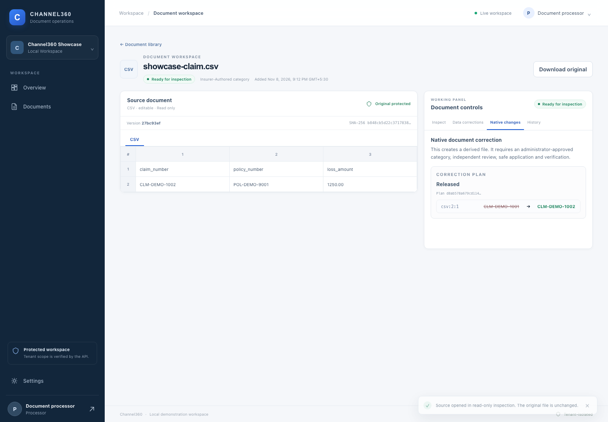 | 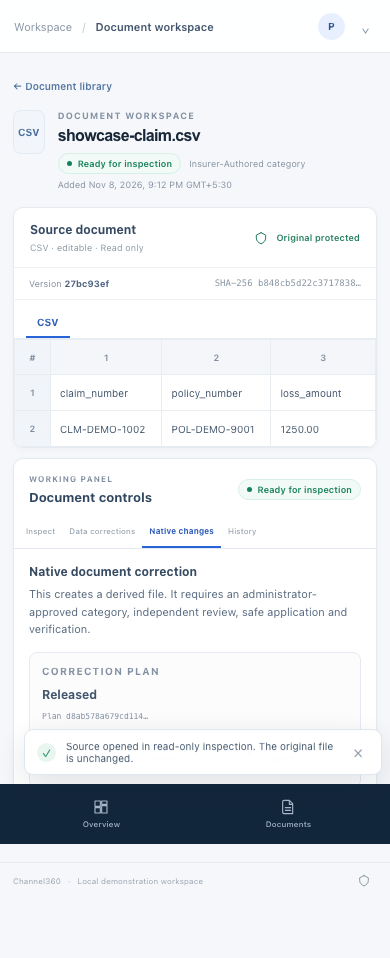 |
| Reviewer queue | 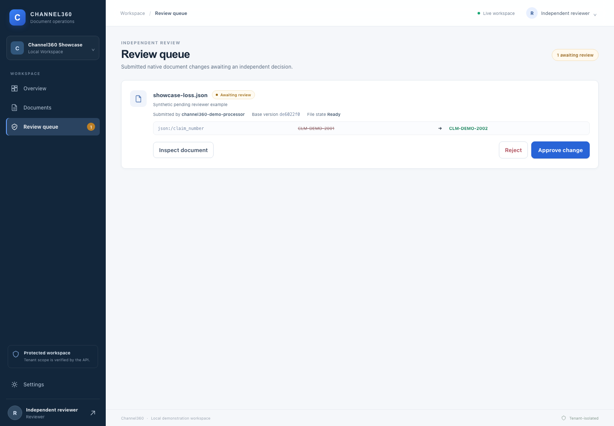 | 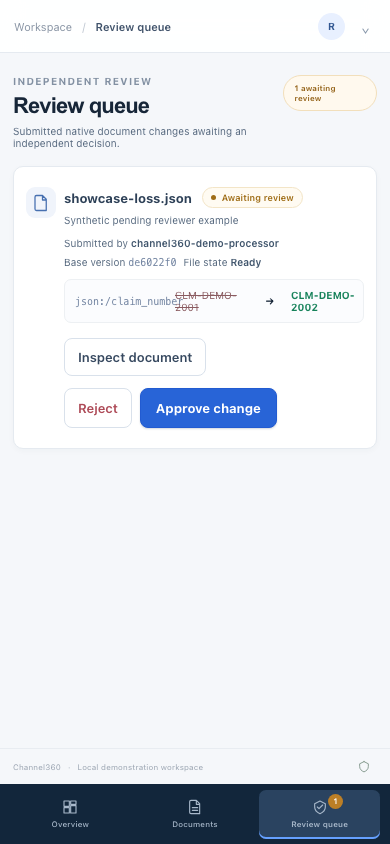 |
| PDF AcroForm workspace | 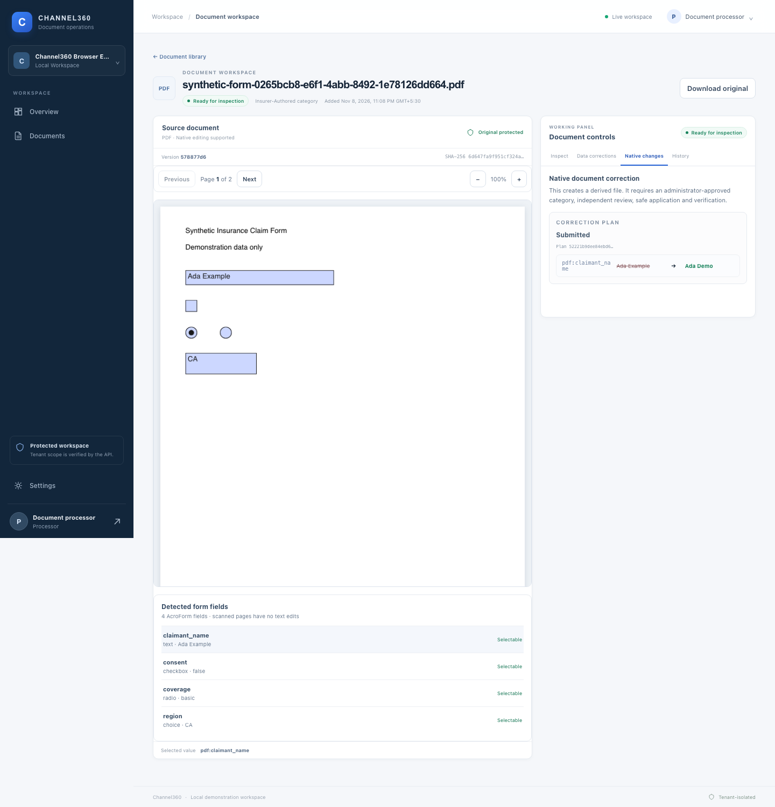 | 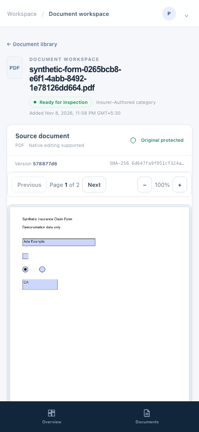 |
| DOCX read-only workspace | 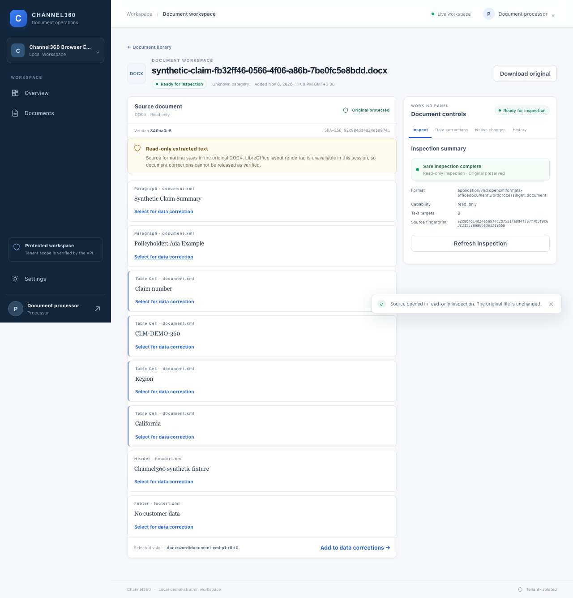 | 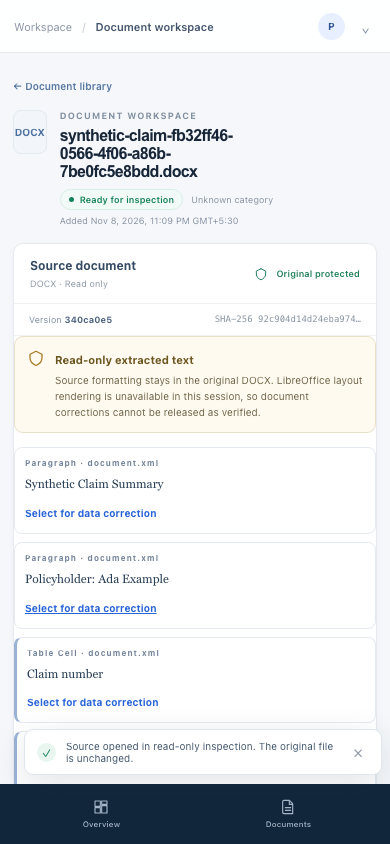 |
| Verification boundary | 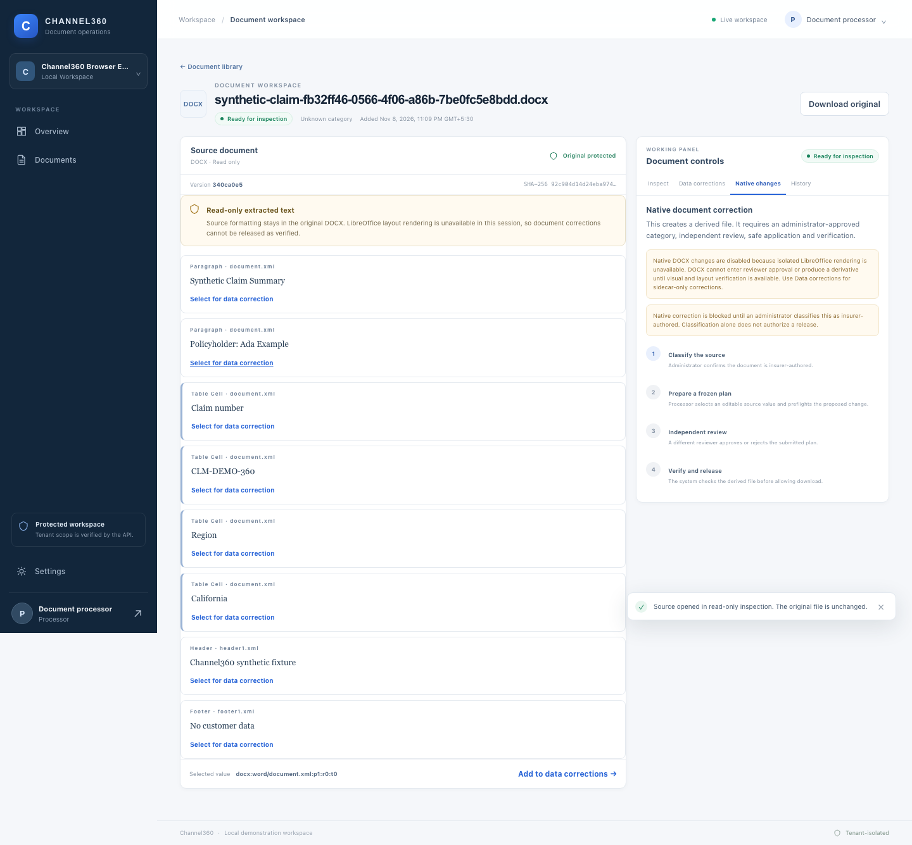 |  |
| Verified release | 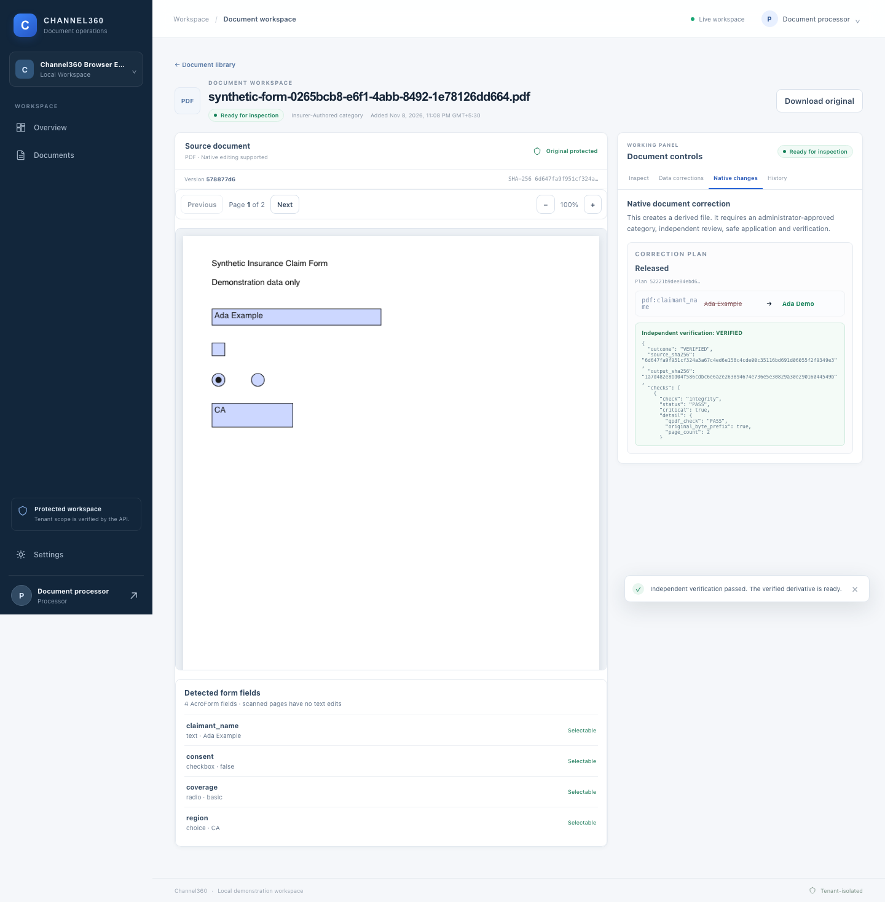 | 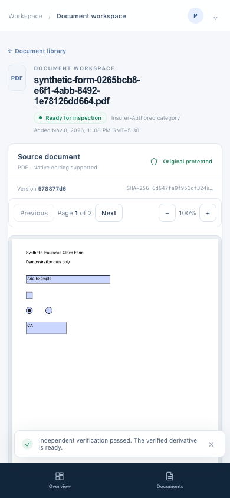 |
| Incomplete XLSX | 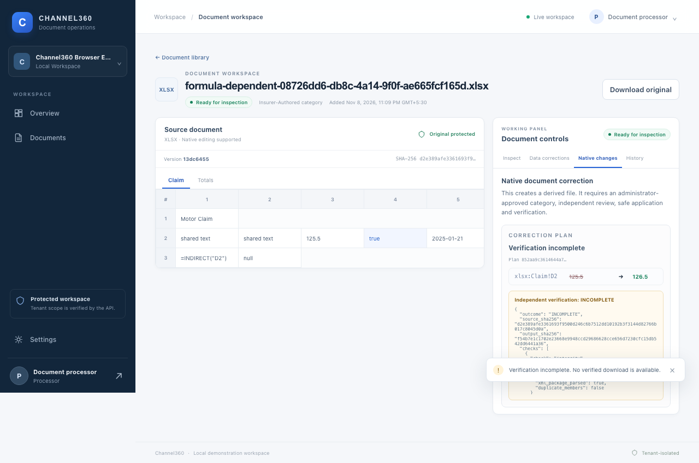 | — |

## Architecture

```text
React + TypeScript (Vite)
          │ bearer session from local-only demo issuer
          ▼
FastAPI ── PostgreSQL (tenant RLS, immutable metadata, audit)
   │
   ├── ClamAV scan before registration/release
   ├── bounded isolated parser and format adapters
   └── deterministic correction + independent verification
          │
          ▼
private local document storage (development)
```

The repository is a modular monolith. PostgreSQL is authoritative for tenant-scoped metadata, approval state, version lineage and audit. The local filesystem adapter is for development only. Upload/inspection currently runs synchronously; Redis/Valkey jobs, retry handling and event streaming are not implemented.

## Technology

- Python 3.12+, FastAPI, SQLAlchemy, Alembic, psycopg and Pydantic.
- PostgreSQL 16 with separate migration, application and worker roles and RLS policies.
- ClamAV daemon socket for fail-closed malware scanning.
- React 19, TypeScript 5.9, Vite 8, PDF.js 4.10.38 and Playwright 1.54.2 for browser validation.
- Deterministic CSV/JSON/XLSX adapters; pypdf incremental AcroForm edits; pypdfium2 rendering; qpdf structure checks; lxml/OOXML DOCX editing; and LibreOffice headless verification when the host isolation boundary permits it.

Pinned dependency manifests are `requirements.txt`, `apps/web/package.json` and `apps/web/package-lock.json`.

## Local requirements

On macOS or Linux, install Python 3.12+, Node.js/npm, PostgreSQL 16, qpdf, LibreOffice, and a running ClamAV daemon with a reachable Unix socket. The supported host validation script currently defaults to `/opt/homebrew/var/run/clamav/clamd.sock` on macOS. Configure PostgreSQL and ClamAV through your local service manager; Channel360 does not install or start system services. On macOS, qpdf and LibreOffice can be installed with `brew install qpdf libreoffice`.

Use a dedicated `channel360_test` database and its Channel360-specific roles. Never point the test scripts at a personal or shared application database. Keep PostgreSQL passwords in a mode-0600 PGPASSFILE outside the repository (the development launcher defaults to `~/.channel360-pgpass`). Do not place passwords in URLs or commit `.env` files.

### Install project dependencies

```sh
python3.12 -m venv .venv
.venv/bin/python -m pip install -r requirements.txt
npm ci --prefix apps/web
.venv/bin/python -m pip install -r requirements-test.txt  # synthetic acceptance fixtures
```

For the actual Chromium browser suite, install the pinned local test runner and browser:

```sh
scripts/host/validate_channel360_e2e.sh browser-setup
```

### PostgreSQL setup

The project provides a read-only preflight and a guarded test-database provisioner. Review `docs/LOCAL_RUN_GUIDE.md` and `scripts/host/validate_channel360_e2e.sh` first. Provision only when the dedicated database and role names are absent and the explicit guard is set. Existing resources are never dropped or reset by the provisioner. The application launcher refuses an unexpected database owner and only bootstraps its explicitly configured synthetic tenant in `channel360_test`.

Keep a mode-0600 PGPASSFILE outside Git with entries for the dedicated application, worker and migration roles. `.env.example` contains placeholders only; use environment variables for non-secret local configuration and never store real secrets in the repository.

### ClamAV setup

Start the locally installed ClamAV daemon using your operating system’s service manager. Configure `IDW_CLAMAV_SOCKET_PATH` to its Unix socket (macOS default shown above). Startup and document registration fail closed if the scanner is unavailable; there is no bypass switch in the app workflow.

## Start and stop

After PostgreSQL roles, PGPASSFILE, ClamAV and dependencies are ready:

```sh
IDW_WEB_PORT=5174 scripts/dev/start.sh
IDW_WEB_PORT=5174 scripts/dev/status.sh
```

Open `http://127.0.0.1:5174` and `http://127.0.0.1:8000/docs`. Local demo identities are issued by the API. The demo issuer must remain disabled outside explicitly configured local development. To stop Channel360:

```sh
scripts/dev/stop.sh
```

The default UI opens the synthetic **Channel360 Showcase** tenant. The host browser runner uses the separate, labeled **Channel360 Browser E2E** tenant, defaults to port 5174, and leaves the app running on success:

```sh
scripts/host/start_and_run_browser_e2e.sh
```

Never run against the showcase tenant for repeated E2E. Existing immutable records in the former demo tenant are retained; tests use unique filenames and do not reset the database.

## Tests

```sh
# Python regression suite
.venv/bin/python -m pytest -q

# Live PostgreSQL/RLS integration tests (channel360_test only)
scripts/host/validate_channel360_e2e.sh postgres

# Real ClamAV checks, including clean, EICAR and fail-closed cases
scripts/host/validate_channel360_e2e.sh clamav

# React TypeScript and production bundle
npm run build --prefix apps/web

# M0 workbook integrity manifest
shasum -a 256 -c artifacts/m0/source-sha256.txt

# Complete local Chromium workflows, including PDF and DOCX fail-closed cases
scripts/host/start_and_run_browser_e2e.sh
```

The Python suite may skip PostgreSQL-marked tests when no database is available. A skipped test is not a pass. Browser, database and scanner test outputs are generated locally and ignored by Git. See [Security validation](docs/SECURITY_VALIDATION_REPORT.md), [host integration guide](docs/HOST_INTEGRATION_VALIDATION.md), and [known limitations](docs/KNOWN_LIMITATIONS.md).

## Milestones and limitations

| Milestone | Current status |
| --- | --- |
| M0 — standalone XLSX correction and verification | Accepted for its standalone scope; formula-dependent outputs intentionally remain incomplete |
| M1 — application, tenancy, storage, inspection and scanning | Core paths implemented and live PostgreSQL, ClamAV and browser integration exercised. Overall M1 remains partial: durable queue/events, full acceptance corpus and OS-level parser isolation evidence are outstanding |
| M2 — data corrections, native edit/review/release | CSV, JSON and XLSX persisted workflows exercised; approval separation and verified-only downloads enforced. Product still requires production identity, deployment and operational hardening |
| M3 — XLSX application integration | Exercised through the persisted review/release path; independent verification preserves incomplete formula-dependent behavior |
| M4 — templates, deterministic rules and structural summaries | Planned, not implemented |
| M5 — supported AcroForm PDF editing | Implemented for a narrow synthetic unsigned-form path and passed a live browser verified download. Full milestone acceptance remains open: the 50-file multi-producer corpus and all PDF-1..PDF-5 acceptance variants are incomplete. |
| M6 — constrained DOCX editing | Adapter, provenance, parser and verifier code are implemented; browser-native editing is intentionally disabled because the host cannot run the isolated LibreOffice check. DOCX-1..DOCX-5 are NOT_VERIFIED as a milestone. |
| M7 — optional OCR/Docling/LLM providers | Planned, not implemented |

Additional limitations include synchronous ingestion, development-only local identities and filesystem storage, sampled (not kernel-enforced) 2 GiB macOS parser RSS monitoring, and an unverified OS-level network boundary on some host configurations. The DOCX safety gate blocks approval until isolated LibreOffice rendering is available. Do not use real policyholder data or treat this prototype as production-ready.

## License

No license has been assigned to this repository.
